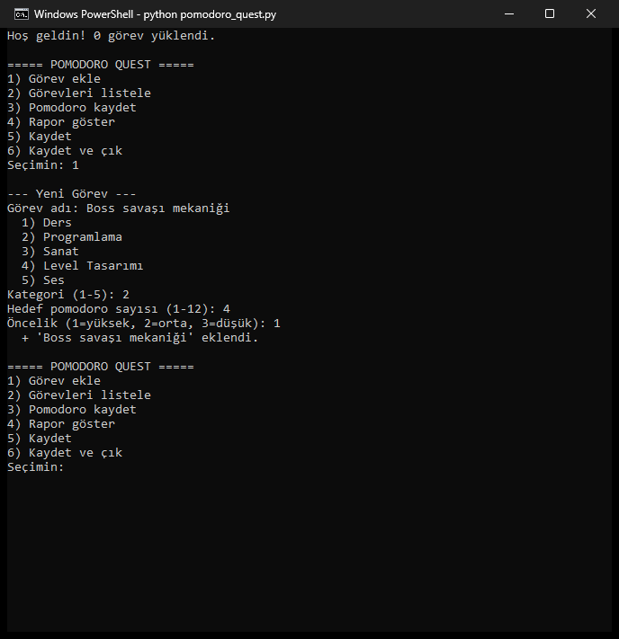
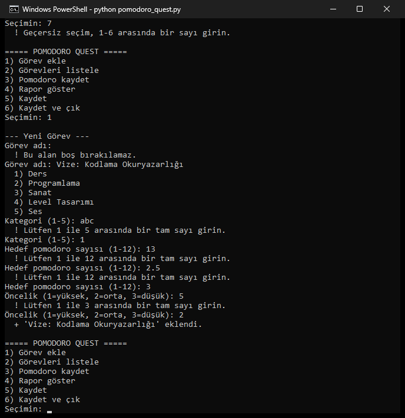
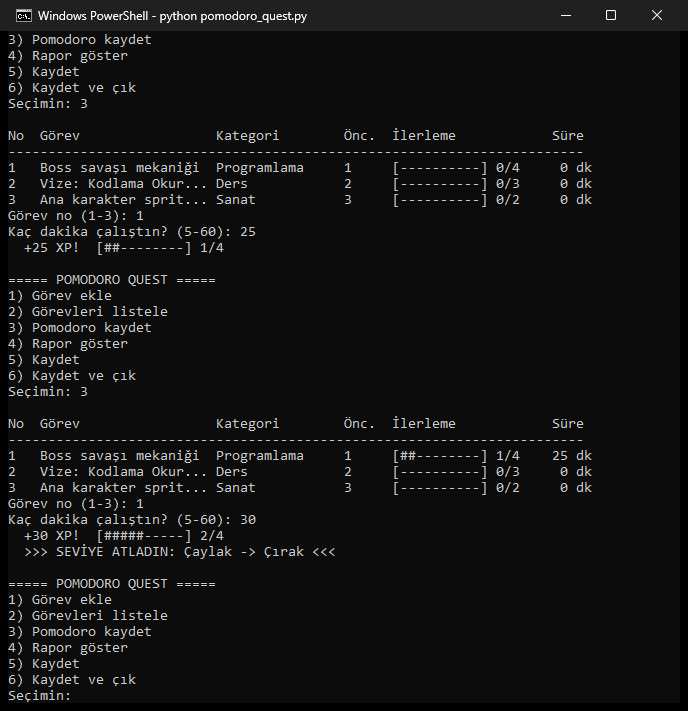
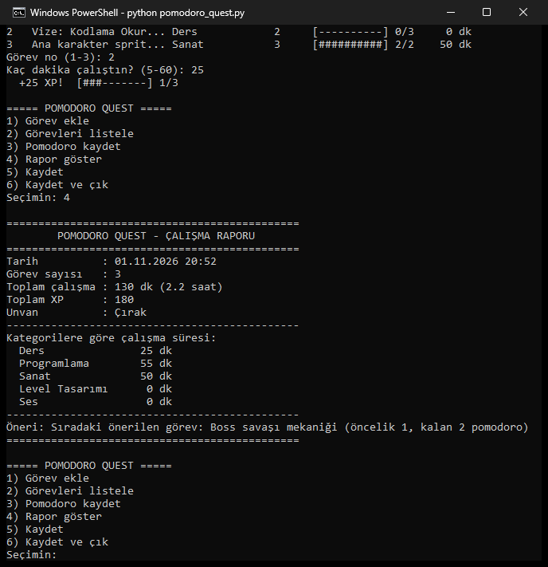
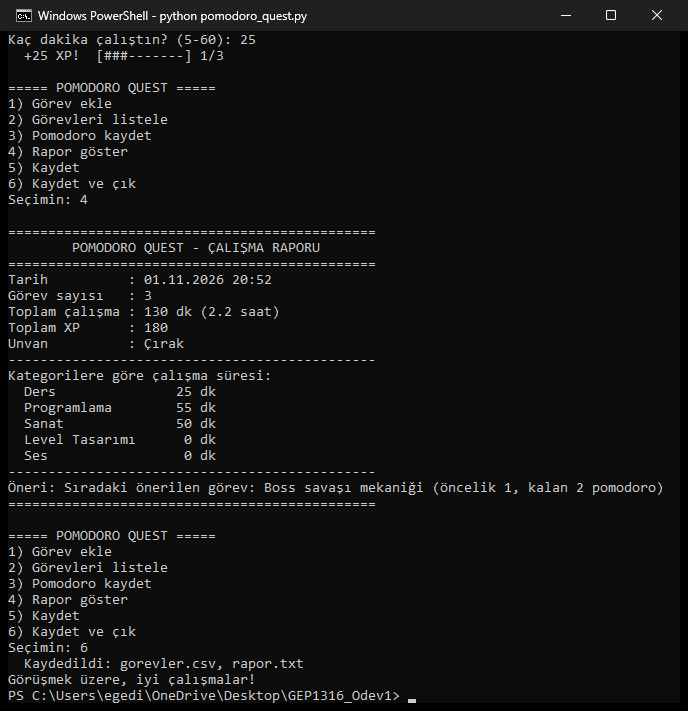

# Pomodoro Quest 🎮⏱️

**Oyunlaştırılmış çalışma planlayıcı ve pomodoro takipçisi.** GEP1316 Kodlama Okuryazarlığı dersinin Ara Değerlendirme Ödevi 1 için hazırlandı.

## Ne yapar?

Oyun tasarımı öğrencileri ve küçük bağımsız oyun ekipleri aynı anda çok farklı işlerle uğraşır: ders, programlama, çizim, level tasarımı, ses. Pomodoro Quest bu işleri **görev (quest)** olarak kaydeder ve her görev için tamamlanan **pomodoroları** (odaklı çalışma blokları) takip eder. Çalışmayı bir oyun gibi ödüllendirir:

- Çalışılan her dakika **1 XP**, tamamlanan her görev **+50 bonus XP** kazandırır.
- XP arttıkça unvan yükselir: **Çaylak → Çırak → Kalfa → Usta → Efsane**
- Rapor ekranında kategorilere göre çalışma süresi ve sıradaki görev için bir **öneri** çıkar.
- Görevler `gorevler.csv` dosyasına, rapor `rapor.txt` dosyasına kaydedilir. Program bir sonraki açılışta kaldığı yerden devam eder.

## Nasıl çalıştırılır?

Python 3.8 veya üstü yeterlidir. Ek kütüphane gerekmez.

```bash
python pomodoro_quest.py
```

Testleri çalıştırmak için:

```bash
python -m unittest -v test_pomodoro_quest.py
```

## Menü

| Seçenek | İşlem |
|---|---|
| 1 | Görev ekle (ad, kategori, hedef pomodoro 1-12, öncelik 1-3) |
| 2 | Görevleri ilerleme çubuğuyla listele |
| 3 | Bir göreve pomodoro kaydet (5-60 dk) |
| 4 | Raporu göster |
| 5 | Kaydet (CSV + TXT) |
| 6 | Kaydet ve çık |

Hatalı girdilerde (harf, boş değer, aralık dışı sayı, ondalıklı sayı) program çökmez. Uyarı verir ve tekrar sorar.

## Ekran görüntüleri

**Menü ve görev ekleme**


**Hatalı girdi uyarıları** (geçersiz menü seçimi, boş ad, harf, aralık dışı ve ondalıklı sayı)


**Pomodoro kaydı, ilerleme çubukları ve seviye atlama**


**Rapor**


**Kaydet ve çık**


Örnek rapor çıktısı (`rapor.txt`):

```
==============================================
        POMODORO QUEST - ÇALIŞMA RAPORU
==============================================
Görev sayısı   : 3
Toplam çalışma : 130 dk (2.2 saat)
Toplam XP      : 180
Unvan          : Çırak
----------------------------------------------
Kategorilere göre çalışma süresi:
  Ders               25 dk
  Programlama        55 dk
  Sanat              50 dk
  Level Tasarımı      0 dk
  Ses                 0 dk
----------------------------------------------
Öneri: Sıradaki önerilen görev: Boss savaşı mekaniği (öncelik 1, kalan 2 pomodoro)
==============================================
```

## Dosyalar

| Dosya | Açıklama |
|---|---|
| `pomodoro_quest.py` | Ana program |
| `test_pomodoro_quest.py` | 19 otomatik test (unittest) |
| `akis_semasi.md` | Akış şeması ve sözde kod |
| `PROMPTLAR.md` | YZ ile çalışma günlüğü |
| `gorevler.csv`, `rapor.txt` | Örnek çıktı dosyaları |

## Kullanılan kavramlar

- **Değişkenler ve operatörler:** XP hesabı, `+=`, `//`, karşılaştırmalar
- **Karar yapıları:** menü seçimi, unvan belirleme (`seviye_bul`), öneri üretme, girdi doğrulama
- **Döngüler:** ana menü `while` döngüsü, doğrulama döngüleri, görevler üzerinde `for`
- **Fonksiyonlar:** 18 fonksiyon (doğrulama, hesaplama, dosya, menü)
- **Liste ve sözlük:** görevler bir sözlük listesidir; `KATEGORILER` listesi, `kategori_ozeti` sözlüğü
- **Dosya işlemleri:** `csv` modülü ile okuma/yazma, `.txt` rapor

## Yapay zekâ kullanımı

Bu proje Claude (Anthropic) yardımıyla geliştirildi. Ayrıntılar [PROMPTLAR.md](PROMPTLAR.md) dosyasında.

Anthropic. (2026). *Claude* [Büyük dil modeli]. https://claude.ai
