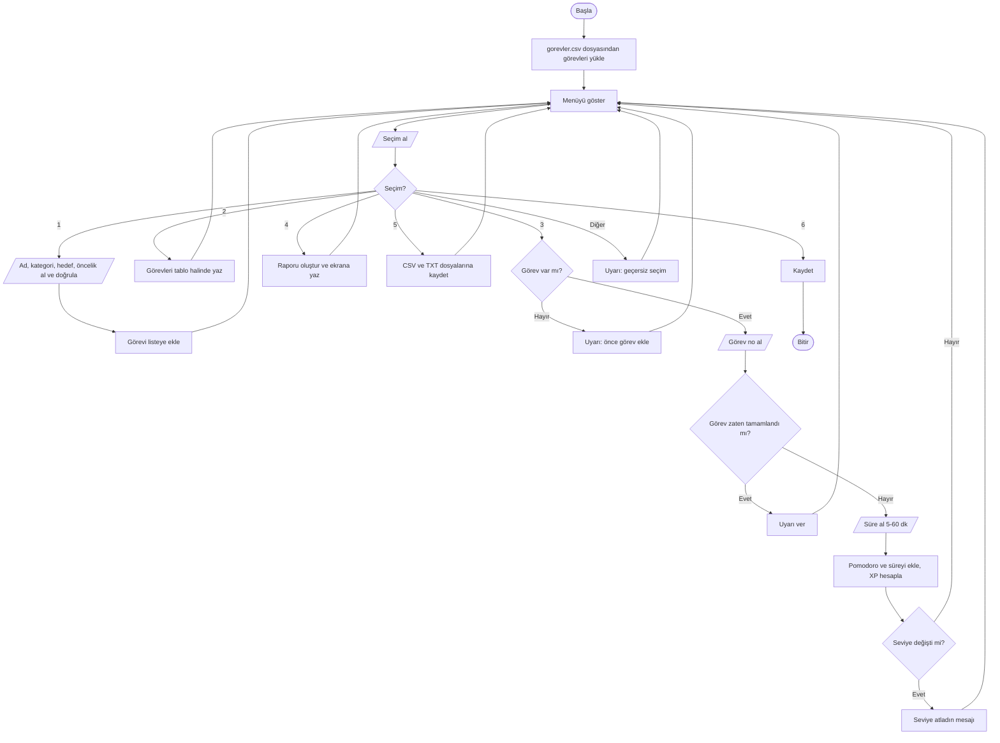

# Akış Şeması ve Sözde Kod

## Akış şeması



## Sözde kod

```
BAŞLA
  görevler ← DOSYADAN_YÜKLE("gorevler.csv")      // dosya yoksa boş liste
  TEKRARLA
    menüyü göster
    seçim ← kullanıcıdan al
    EĞER seçim = 1 İSE
        ad      ← boş olmayan metin al
        kategori← 1-5 arası sayı al, listeden kategoriyi seç
        hedef   ← 1-12 arası sayı al
        öncelik ← 1-3 arası sayı al
        görevi listeye ekle (tamamlanan = 0, dakika = 0)
    DEĞİLSE EĞER seçim = 2 İSE
        her görev için: no, ad, kategori, öncelik, ilerleme çubuğu, süre yaz
    DEĞİLSE EĞER seçim = 3 İSE
        EĞER görev yoksa uyar ve menüye dön
        görev ← kullanıcının seçtiği görev
        EĞER görev tamamlandıysa uyar
        DEĞİLSE
            süre ← 5-60 arası sayı al
            görev.tamamlanan ← görev.tamamlanan + 1
            görev.dakika ← görev.dakika + süre
            EĞER tamamlanan = hedef İSE "görev tamamlandı, +50 XP" yaz
            EĞER unvan değiştiyse "seviye atladın" yaz
    DEĞİLSE EĞER seçim = 4 İSE  raporu ekrana yaz
    DEĞİLSE EĞER seçim = 5 İSE  CSV ve TXT'ye kaydet
    DEĞİLSE EĞER seçim = 6 İSE  kaydet ve döngüden çık
    DEĞİLSE "geçersiz seçim" uyarısı ver
  SON
BİTİR

SAYI_AL(mesaj, en_az, en_çok):
  TEKRARLA
    metin ← kullanıcıdan al
    EĞER metin tam sayıya çevrilebiliyorsa VE en_az ≤ sayı ≤ en_çok İSE sayıyı döndür
    DEĞİLSE uyarı yaz ve tekrar sor

UNVAN(xp):
  EĞER xp ≥ 1000 → "Efsane"
  DEĞİLSE EĞER xp ≥ 500 → "Usta"
  DEĞİLSE EĞER xp ≥ 200 → "Kalfa"
  DEĞİLSE EĞER xp ≥ 50  → "Çırak"
  DEĞİLSE → "Çaylak"
```
